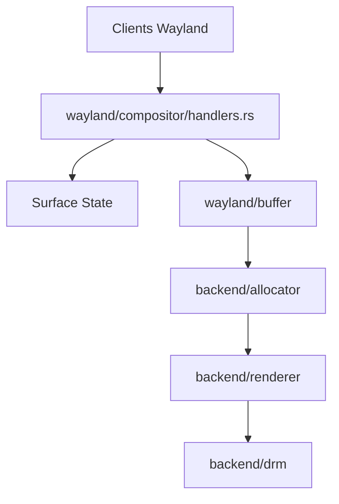

# Smithay/smithay

> Rust building blocks for writing Wayland compositors, for those developing a desktop environment.

## The problem
Writing a Wayland compositor means reimplementing protocols, input, rendering and session management.

## What it actually does
Provides Rust modules for the core Wayland protocols and extensions, input handling (libinput), session, allocation, rendering and the DRM driver, plus helpers for popups, desktop spaces and XWayland. Modular: you only use what you need. Example: the `anvil` compositor.

## How it is wired

## Trying it
No command in the README: online getting-started guide and the `anvil` README.

## Cost and gotchas
Free. Many system dependencies (libwayland, libinput, libgbm, libseat, libEGL...). Rust required, missing from the list of prerequisites.

## What it is not
Not a complete compositor nor a constraining framework: you must write your own. No use outside Wayland.

## Alternatives
No alternative cited in the README.

## For you
Ignore: low-level graphics and Linux desktop, unrelated to data, AI or MLOps work.
