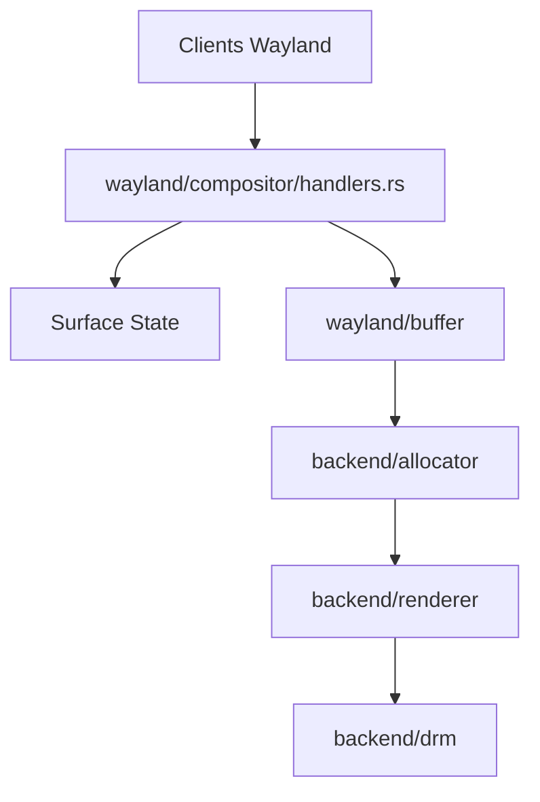

# Smithay/smithay

> Briques Rust pour construire des compositeurs Wayland, pour qui développe un environnement de bureau.

## Le problème
Écrire un compositeur Wayland impose de réimplémenter protocoles, entrées, rendu et gestion de session.

## Ce que ça fait vraiment
Fournit des modules Rust pour les protocoles Wayland de base et des extensions, la gestion d'entrées (libinput), session, allocation, rendu et pilote DRM, plus des aides pour popups, espaces de bureau et XWayland. Modulaire : on n'utilise que ce dont on a besoin. Exemple : le compositeur `anvil`.

## Comment c'est branché

## Essayer
Aucune commande dans le README : guide de démarrage en ligne et README d'`anvil`.

## Coût et pièges
Gratuit. Dépendances système nombreuses (libwayland, libinput, libgbm, libseat, libEGL...). Rust requis, absent de la liste des prérequis.

## Ce que ce n'est pas
Pas un compositeur complet ni un framework contraignant : il faut écrire le sien. Aucun usage hors Wayland.

## Alternatives
Aucune alternative citée dans le README.

## Pour toi
Ignorer : bas niveau graphique et bureau Linux, sans lien avec un travail data, IA ou MLOps.

