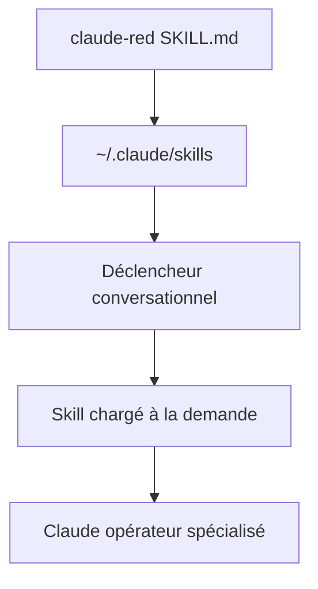

# SnailSploit/Claude-Red

> Library of offensive security skills for Claude, as SKILL.md files.

## The problem
Turning Claude into a contextual red team operator means injecting the expert methodology for an attack surface every time. Nothing is reusable or loaded on demand.

## What it actually does
Curated library of offensive skills for Claude's Skills system. Each `SKILL.md` primes Claude with the methodology of an attack surface (SQLi, XSS, SSRF, exploit dev, EDR evasion, ADCS, wireless, cloud, K8s, C2…). Loaded on demand from conversational triggers: no context cost for unused skills. ~90 skills in 23 categories. Use cases: authorized red team engagements, bug bounty, research, CTF, training.

## How it is wired


## Trying it
```bash
git clone https://github.com/SnailSploit/claude-red ~/.claude/skills/claude-red
```
```bash
./install.sh --category web
```

## Cost and gotchas
Free, nothing to install on the runtime side. Offensive content: reserved for authorized engagements, CTF, research. Single maintainer. Effectiveness depends on the model and the quality of the SKILL.md files.

## What it is not
Not executable tools: methodology files that steer Claude's behavior. Not intended for unauthorized use.

## Alternatives
Not named in the README.

## For you
Interesting if you do authorized pentesting/CTF with Claude; otherwise outside your data/AI focus — watch as a skills curiosity.
