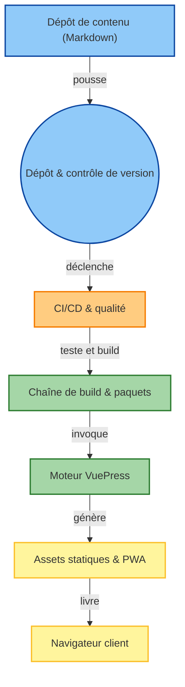

# Snailclimb/JavaGuide

> Chinese collection of study notes for Java backend developer interview questions.

## The problem
Preparing for a backend interview requires expertise in Java, the JVM, networking, SQL, Redis, and distributed systems.
However, the resources available are scattered and of varying quality.

## What it actually does
Provides hundreds of Markdown-formatted notes: Java basics, collections, concurrency, JVM, new features by version.
Also covers OS, networking, data structures, MySQL, Redis, MongoDB, Spring, security, and distributed systems.
Published as a static VuePress website, accessible online at javaguide.cn.
Links to paid content created by the author (interview guide, system design questions).

## How it is wired

## Trying it
No installation instructions are documented: the software can be accessed and used through javaguide.cn or in the `docs/` directory.

## Cost and gotchas
The repository is free; several related resources are paid. Content is almost exclusively in Chinese.

No license is declared in the README, which explicitly prohibits redistribution without attribution.

## What it is not
Not a course: a list of study sheets, focused on passing the interview rather than practical application.
No content on data, ML, or MLOps; the AI section refers to another repository by the same author.
No executable code – this is documentation.

## Alternatives
- `shareAI-lab/learn-claude-code`: same educational format, but on the topic of agents rather than Java.

## For you
Outside the data/AI scope, and in Chinese. Please disregard.
