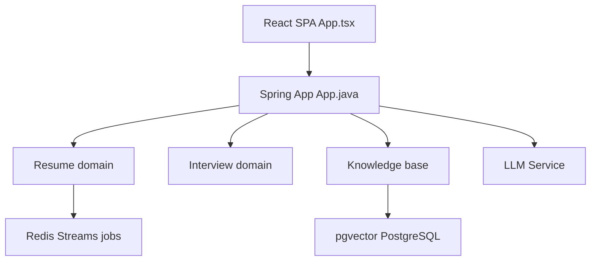

# Snailclimb/interview-guide

> Spring AI platform for resume analysis, mock interviews (text and voice) and a RAG knowledge base.

## The problem
Preparing for an interview without structured feedback; analyzing resumes or managing an interview schedule requires separate tools.

## What it actually does
Spring Boot backend (Java 25) and React frontend. Asynchronous resume analysis (Redis Stream), mock interviews driven by skills (10+ tracks), shared text/voice evaluation, real-time voice interview (WebSocket, Qwen3 ASR/TTS), schedule with calendar, RAG knowledge base with pgvector, generated question bank. PDF reports.

## How it is wired


## Trying it
```bash
cp .env.example .env
# renseigner AI_BAILIAN_API_KEY
docker-compose up -d --build
```

## Cost and gotchas
A DashScope (Alibaba Cloud) key is required, including for voice. On Docker: PostgreSQL, Redis, MinIO. Default service passwords must be changed. The accompanying tutorial is paid. AGPL-3.0 license: modified code exposed over a network must be published.

## What it is not
Not a hosted service. Voice has known limits (latency, echo). README in Chinese.

## Alternatives
No alternative named in the README.

## For you
Worth watching as a complete Spring AI + RAG + pgvector example; useful for learning the architecture, less so as a tool to deploy as is.
