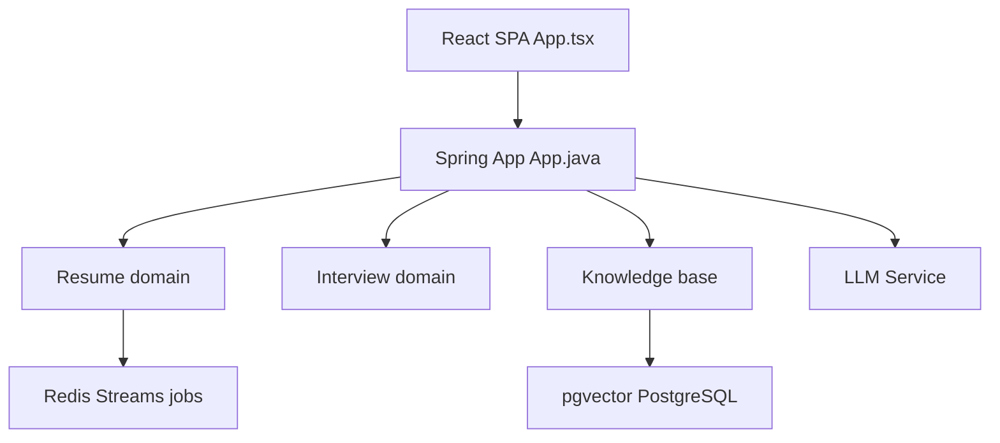

# Snailclimb/interview-guide

> Plateforme Spring AI d'analyse de CV, d'entretiens simulés (texte et voix) et de base de connaissances RAG.

## Le problème
Se préparer à un entretien sans retour structuré ; analyser des CV ou gérer un agenda d'entretiens demande des outils séparés.

## Ce que ça fait vraiment
Backend Spring Boot (Java 25) et frontend React. Analyse de CV asynchrone (Redis Stream), entretiens simulés pilotés par des skills (10+ directions), évaluation commune texte/voix, entretien vocal temps réel (WebSocket, Qwen3 ASR/TTS), agenda avec calendrier, base de connaissances RAG avec pgvector, banque de questions générées. Rapports PDF.

## Comment c'est branché


## Essayer
```bash
cp .env.example .env
# renseigner AI_BAILIAN_API_KEY
docker-compose up -d --build
```

## Coût et pièges
Clé DashScope (Alibaba Cloud) requise, y compris pour la voix. Sur Docker : PostgreSQL, Redis, MinIO. Mots de passe par défaut des services à changer. Le tutoriel associé est payant. Licence AGPL-3.0 : le code modifié exposé en réseau doit être publié.

## Ce que ce n'est pas
Pas un service hébergé. La voix a des limites connues (latence, écho). README en chinois.

## Alternatives
Aucune alternative nommée dans le README.

## Pour toi
À surveiller comme exemple complet Spring AI + RAG + pgvector ; utile pour apprendre l'architecture, moins comme outil à déployer tel quel.

