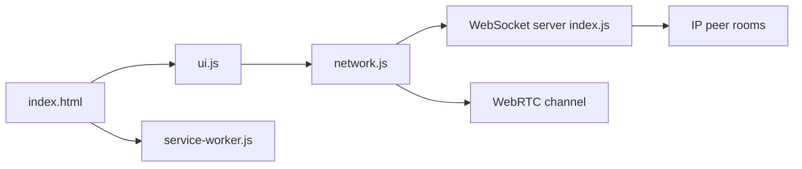

# SnapDrop/snapdrop

> File sharing between devices on the same network via the browser, AirDrop-style.

## The problem
Sending a file from a phone to a computer without a cable, account or dedicated app.

## What it actually does
The Node server groups clients by public IP and relays WebSocket signaling; browsers then negotiate a WebRTC channel and send each other files or text, split into chunks. Installable web application (service worker). The project was acquired by LimeWire; the repo stays frozen for the "classic" self-hosted version.

## How it is wired


## Trying it
```bash
# Aucune commande exacte dans le README : il indique seulement
# qu'on peut héberger sa propre instance avec Docker.
```

## Cost and gotchas
GPL-3.0 license. Last push in February 2025, 287 open issues; the public service is now LimeWire's (storage, AI tools, accounts).

## What it is not
Neither a storage service nor an actively maintained tool: the repo "stays as is".

## Alternatives
snapdrop.net / limewire.com: commercial service that took over the project.

## For you
One-off help on a local network; no contribution to a data/AI workflow.
