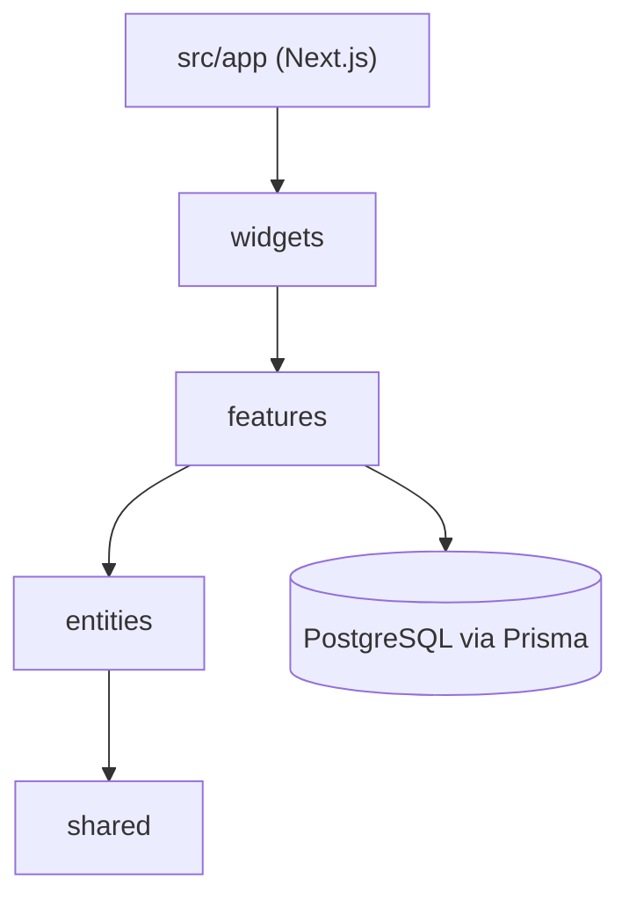

# Snouzy/workout-cool

> Self-hostable fitness coaching platform with an exercise database, for creating programs and tracking progress.

## The problem
Open source fitness platforms have shut down, for lack of an affordable exercise video provider.

## What it actually does
Next.js application (App Router, Feature-Sliced Design architecture) with Prisma and PostgreSQL, Better Auth authentication. Workout programs, tracking, exercise database imported from a CSV. Docker or manual deployment.

## How it is wired

Diagram based on the structure described in the README.

## Trying it
```bash
git clone https://github.com/Snouzy/workout-cool.git
cd workout-cool
cp .env.example .env
make dev
pnpm install
npx prisma migrate dev
pnpm dev
pnpm run import:exercises-full ./data/sample-exercises.csv
```

## Cost and gotchas
Node 18+, pnpm 8+, Docker, PostgreSQL. Exercise videos are not provided: the README cites them as expensive to license.

## What it is not
Not a complete exercise database: only a sample is included.

## Alternatives
No alternative named in the README; it is the revival of workout.lol, which was abandoned.

## For you
Ignore: fitness app with no link to data/AI/MLOps, useful only as a Next.js and Prisma example.
