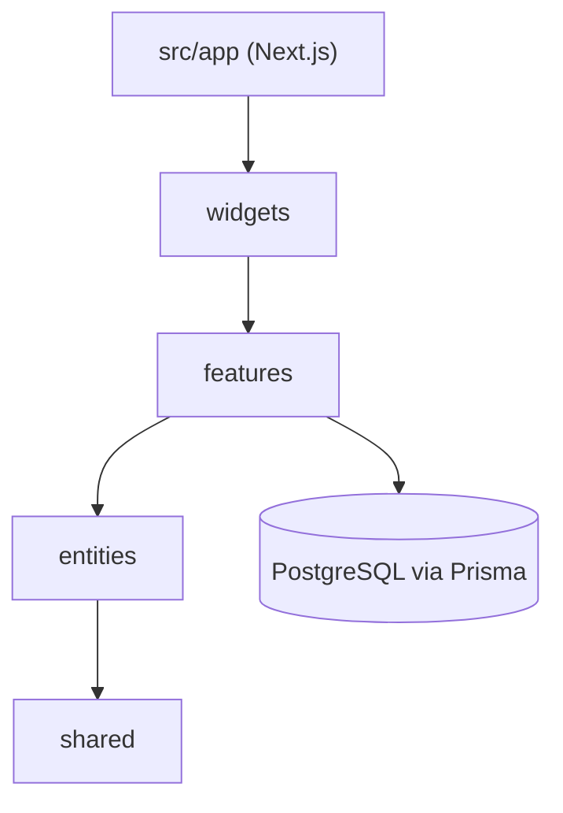

# Snouzy/workout-cool

> Plateforme de coaching sportif auto-hébergeable avec base d'exercices, pour créer des programmes et suivre sa progression.

## Le problème
Les plateformes de fitness open source se sont arrêtées, faute de fournisseur de vidéos d'exercices abordable.

## Ce que ça fait vraiment
Application Next.js (App Router, architecture Feature-Sliced Design) avec Prisma et PostgreSQL, authentification Better Auth. Programmes d'entraînement, suivi, base d'exercices importée depuis un CSV. Déploiement Docker ou manuel.

## Comment c'est branché

Schéma d'après la structure décrite dans le README.

## Essayer
```bash
git clone https://github.com/Snouzy/workout-cool.git
cd workout-cool
cp .env.example .env
make dev
pnpm install
npx prisma migrate dev
pnpm dev
pnpm run import:exercises-full ./data/sample-exercises.csv
```

## Coût et pièges
Node 18+, pnpm 8+, Docker, PostgreSQL. Les vidéos d'exercices ne sont pas fournies : le README les cite comme coûteuses à licencier.

## Ce que ce n'est pas
Pas une base de données d'exercices complète : seul un échantillon est inclus.

## Alternatives
Aucune alternative nommée dans le README ; il s'agit du renouveau de workout.lol, abandonné.

## Pour toi
Ignorer : appli de fitness sans lien avec la data/IA/MLOps, utile seulement comme exemple Next.js et Prisma.

