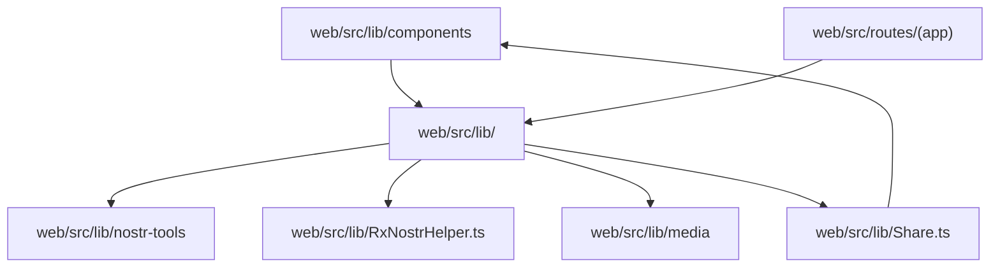

# SnowCait/nostter

> Web client for the decentralized social network Nostr, written in Svelte.

## The problem
Using Nostr requires a client that handles relays, signing extensions and keys.

## What it actually does
A SvelteKit application: components and routes call utility libraries, which talk to the network through nostr-tools and rx-nostr. Login via NIP-07 extension, nsec or read-only npub; share link and bookmarklet.

## How it is wired


## Trying it
```bash
# Lien de partage
https://nostter.app/post?content={url-encoded-text-here}
```

## Cost and gotchas
Free; recent browsers required (Chrome 114+, Firefox 125+, Safari 17+). Entering an nsec in a web client exposes the private key: the extension is recommended.

## What it is not
Not a relay nor a Nostr server: only a client. No build command documented in the README.

## Alternatives
No alternative named.

## For you
Ignore: decentralized social client, outside data/AI/MLOps.
