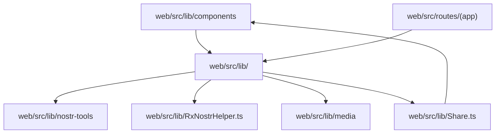

# SnowCait/nostter

> Client web pour le réseau social décentralisé Nostr, écrit en Svelte.

## Le problème
Utiliser Nostr demande un client qui gère les relais, les extensions de signature et les clés.

## Ce que ça fait vraiment
Application SvelteKit : composants et routes appellent des bibliothèques utilitaires, qui parlent au réseau via nostr-tools et rx-nostr. Connexion par extension NIP-07, nsec ou npub en lecture seule ; lien et bookmarklet de partage.

## Comment c'est branché


## Essayer
```bash
# Lien de partage
https://nostter.app/post?content={url-encoded-text-here}
```

## Coût et pièges
Gratuit ; navigateurs récents requis (Chrome 114+, Firefox 125+, Safari 17+). Entrer une nsec dans un client web expose la clé privée : l'extension est recommandée.

## Ce que ce n'est pas
Pas un relais ni un serveur Nostr : seulement un client. Aucune commande de build documentée dans le README.

## Alternatives
Aucune alternative nommée.

## Pour toi
À ignorer : client social décentralisé, hors data/IA/MLOps.

