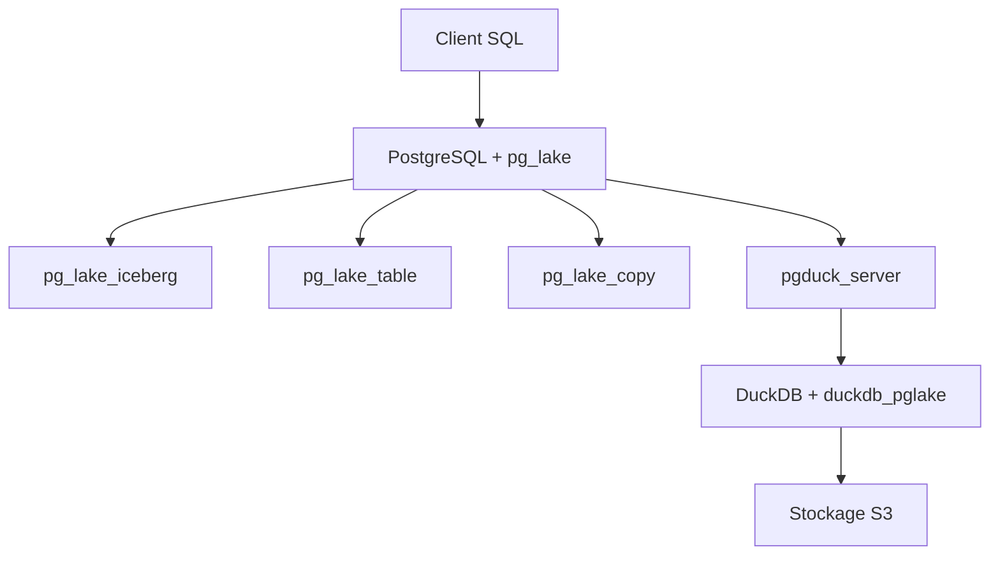

# Snowflake-Labs/pg_lake

> Postgres extensions that turn Postgres into a lakehouse: Iceberg tables and Parquet, CSV, JSON files on S3.

## The problem
To query a data lake, you need a separate engine, and Postgres cannot write transactional Iceberg tables.

## What it actually does
`CREATE TABLE ... USING iceberg` creates an Iceberg table that can be modified in SQL. `COPY` imports and exports to S3, and a foreign table reads files in place with inferred columns. Execution is delegated to DuckDB by `pgduck_server`, a separate process that speaks the Postgres protocol. You can mix Postgres tables, Iceberg and files in the same query.

## How it is wired


## Trying it
```sql
CREATE EXTENSION pg_lake CASCADE;
SET pg_lake_iceberg.default_location_prefix TO 's3://testbucket/pglake';
CREATE TABLE iceberg_test USING iceberg
AS SELECT i AS key, 'val_' || i AS val FROM generate_series(0, 99) i;
```

## Cost and gotchas
Free, Apache-2.0. You need S3-compatible storage and cloud credentials. `pgduck_server` takes 80% of memory by default: tune it. The build applies patches to Avro and DuckDB, whose licenses remain the original ones. 130 open issues.

## What it is not
Not a managed warehouse nor a separate Iceberg catalog: it is extended Postgres. The link with Crunchy Data Warehouse is historical, with an automatic upgrade path.

## Alternatives
- No alternative named in the README.

## For you
Adopt on a trial basis: it simplifies the path between Postgres and the Iceberg lake, with DuckDB under the hood and Snowflake's backing.
