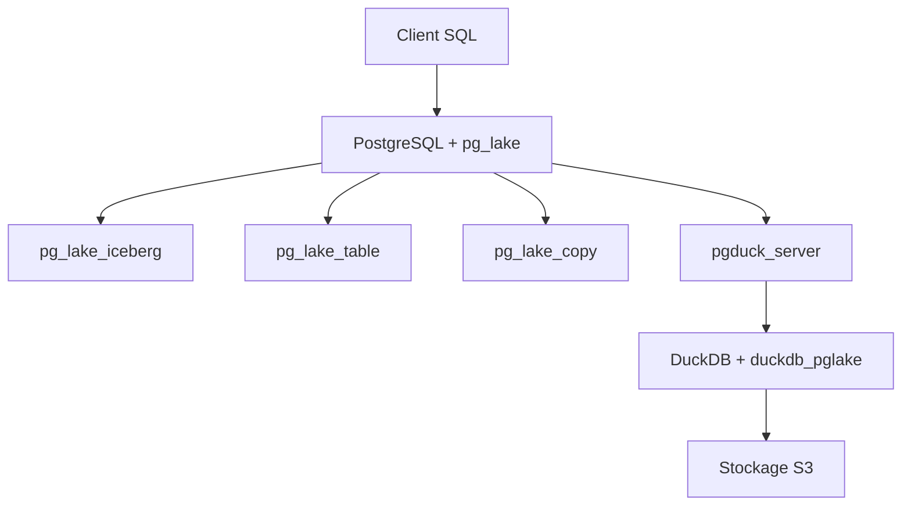

# Snowflake-Labs/pg_lake

> Extensions Postgres qui font de Postgres un lakehouse : tables Iceberg et fichiers Parquet, CSV, JSON sur S3.

## Le problème
Pour interroger un lac de données, il faut un moteur à part, et Postgres ne sait pas écrire de tables Iceberg transactionnelles.

## Ce que ça fait vraiment
`CREATE TABLE ... USING iceberg` crée une table Iceberg modifiable en SQL. `COPY` importe et exporte vers S3, et une table distante lit des fichiers en place avec colonnes inférées. L'exécution est déléguée à DuckDB par `pgduck_server`, un processus séparé qui parle le protocole Postgres. On peut mêler tables Postgres, Iceberg et fichiers dans une même requête.

## Comment c'est branché


## Essayer
```sql
CREATE EXTENSION pg_lake CASCADE;
SET pg_lake_iceberg.default_location_prefix TO 's3://testbucket/pglake';
CREATE TABLE iceberg_test USING iceberg
AS SELECT i AS key, 'val_' || i AS val FROM generate_series(0, 99) i;
```

## Coût et pièges
Gratuit, Apache-2.0. Il faut un stockage compatible S3 et des identifiants cloud. `pgduck_server` prend par défaut 80 % de la mémoire : à régler. Le build applique des patches à Avro et à DuckDB, dont les licences restent celles d'origine. 130 issues ouvertes.

## Ce que ce n'est pas
Pas un entrepôt géré ni un catalogue Iceberg séparé : c'est Postgres étendu. Le lien avec Crunchy Data Warehouse est historique, avec chemin de mise à jour automatique.

## Alternatives
- Aucune alternative nommée dans le README.

## Pour toi
À adopter à l'essai : il simplifie le chemin entre Postgres et le lac Iceberg, avec DuckDB sous le capot et le soutien de Snowflake.

