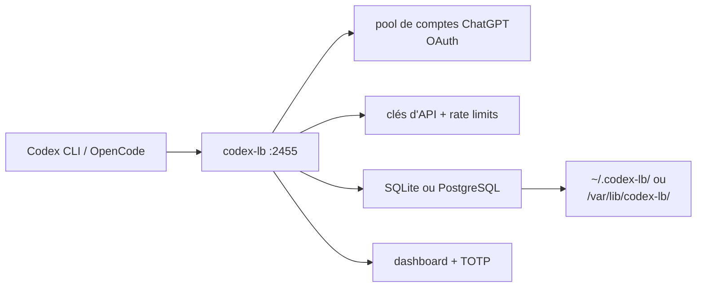

# Soju06/codex-lb

> Load balancer for ChatGPT accounts, with usage tracking and a dashboard, for personal use.

## The problem
A single ChatGPT account quickly hits its rate limits, and you don't know what you are consuming.
Pointing several different clients at several accounts takes plumbing.

## What it actually does
Account pooling with load balancing, per-account tracking (tokens, cost, 28-day trend),
internal API keys with limits per token, cost, window and model.
Dashboard authentication by password and optional TOTP. OpenAI-compatible endpoints,
so usable by Codex CLI/IDE, OpenCode, OpenClaw, Hermes Agent and the Python SDK.
Automatic synchronization of the list of models available upstream.

## How it is wired


## Trying it
```bash
docker volume create codex-lb-data
docker network create codex-lb-net
docker run -d --name codex-lb --network codex-lb-net -p 2455:2455 -p 1455:1455 -v codex-lb-data:/var/lib/codex-lb ghcr.io/soju06/codex-lb:latest
uvx codex-lb
nix run github:Soju06/codex-lb
```

## Cost and gotchas
The software is free; it assumes several paid ChatGPT accounts. A single-use bootstrap token
is required for the first remote access to the dashboard. SQLite by default,
PostgreSQL via `CODEX_LB_DATABASE_URL`. Back up the data directory.

## What it is not
It is not a model provider nor a multi-vendor gateway: it is a proxy to ChatGPT.
It is not a use intended by the upstream provider — pooling subscription accounts
is a contractual risk the README does not address.

## Alternatives
None named in the README.

## For you
To be set aside in a professional setting; the idea worth keeping is per-key usage tracking, not account pooling.
