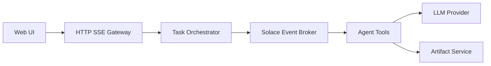

# SolaceLabs/solace-agent-mesh

> Deprecated Python framework for event-driven multi-agent systems, on the Solace broker.

## The problem
Making several specialized agents cooperate without tight coupling, using event messaging.

## What it actually does
A2A agent host combining Google ADK and Solace AI Connector: delegating orchestrator, HTTP/SSE gateway with web interface, Slack and REST, SQL/JQ/visualization tools, dynamic embeds, artifact management, workflows, scheduler and plugins. Commands `sam init`, `sam run`, `sam add agent`.

## How it is wired


## Trying it
```bash
pip3 install solace-agent-mesh
sam init --gui
sam run
```

## Cost and gotchas
The repository is archived and the Python version is deprecated: no more features, fixes or security updates. Requires a Solace broker and an LLM provider key.

## What it is not
It is no longer the version to follow: the README points to a new version and a free desktop application, outside this repository.

## Alternatives
The README points to the new version of Solace Agent Mesh (Solace documentation).

## For you
Ignore: archived and deprecated, with no security fixes; do not start a project on it.
