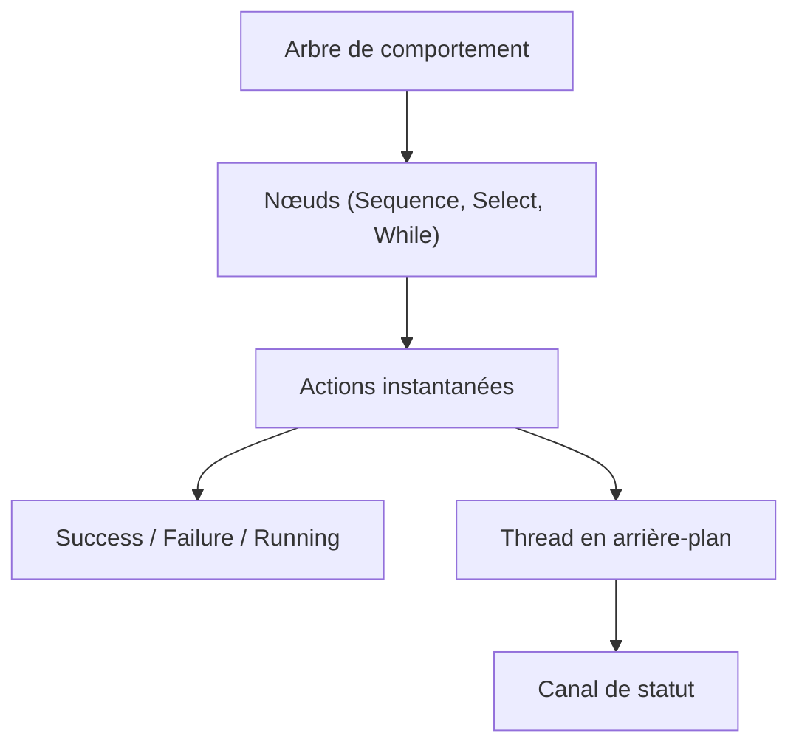

# Sollimann/bonsai

> Rust implementation of behavior trees, with a Python binding, for games, robotics and AI.

## The problem
Hand-coding state machines for complex behaviors quickly becomes unreadable and unresponsive.

## What it actually does
Provides composable nodes: Sequence, Select, If, Invert, Timeout, While, WhenAll, WhenAny, Race, After. Each node returns Success, Failure or Running. Long tasks are launched on threads and tracked through a channel; an asynchronous drone example is provided.

## How it is wired
Simplified diagram based on the sheet, no diagram provided.



## Trying it
```bash
pip install bonsai-bt
# Rust : ajouter bonsai-bt = "*" dans Cargo.toml
```

## Cost and gotchas
Free. Actions must return immediately, otherwise the tree blocks. The README recommends version `*` in Cargo.toml, which is imprudent.

## What it is not
Not an LLM agent framework: these are deterministic decision trees. The examples are in a folder, not detailed in the README.

## Alternatives
No alternative named in the README.

## For you
Ignore unless you do robotics or games: no link to a data or MLOps pipeline, and a single maintainer.
