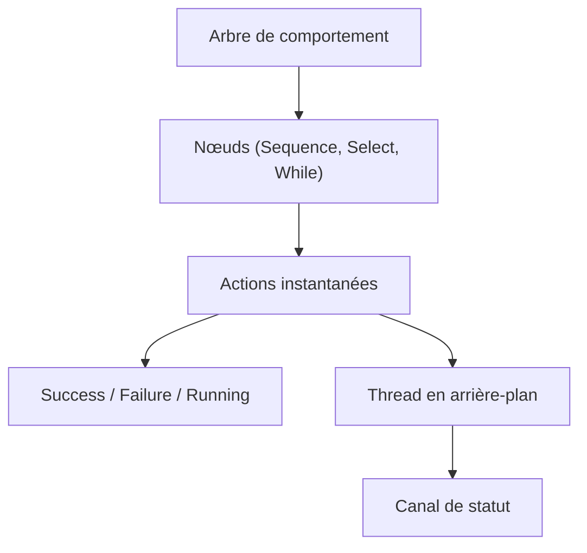

# Sollimann/bonsai

> Implémentation Rust d'arbres de comportement, avec liaison Python, pour jeux, robotique et IA.

## Le problème
Coder à la main des machines à états pour des comportements complexes devient vite illisible et peu réactif.

## Ce que ça fait vraiment
Fournit des nœuds composables : Sequence, Select, If, Invert, Timeout, While, WhenAll, WhenAny, Race, After. Chaque nœud rend Success, Failure ou Running. Les tâches longues se lancent sur des threads et se suivent par canal ; un exemple de drone asynchrone est fourni.

## Comment c'est branché
Schéma simplifié d'après la fiche, sans diagramme fourni.



## Essayer
```bash
pip install bonsai-bt
# Rust : ajouter bonsai-bt = "*" dans Cargo.toml
```

## Coût et pièges
Gratuit. Les actions doivent rendre la main tout de suite, sinon l'arbre se bloque. Le README conseille la version `*` dans Cargo.toml, peu prudente.

## Ce que ce n'est pas
Pas un framework d'agents LLM : ce sont des arbres de décision déterministes. Les exemples sont dans un dossier, non détaillés dans le README.

## Alternatives
Aucune alternative nommée dans le README.

## Pour toi
À ignorer sauf robotique ou jeu : pas de lien avec un pipeline data ou MLOps, et un seul mainteneur.

