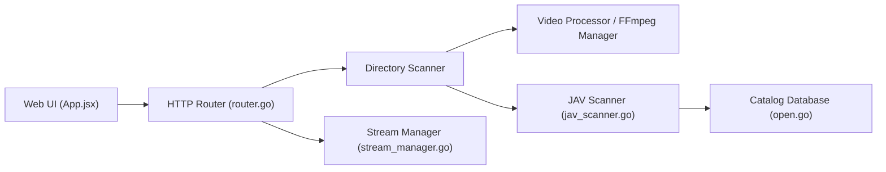

# Solr159/JavBoss

> Local video library manager, with a specialized mode for Japanese adult videos, in Chinese.

## The problem
Cataloguing, fetching metadata for and playing large volumes of local videos requires combining several pieces of software.

## What it actually does
Go server with a React interface: it scans folders, generates thumbnails (ffmpeg), fetches metadata from third-party sites, manages tags and favorites, and plays in the browser or via MPV. Chrome extension for assisted input and for downloading magnet links via CloudDrive2. "Video" and "JAV" modes.

## How it is wired


## Trying it
```bash
curl -fsSL https://raw.githubusercontent.com/Solr159/JavBoss/main/scripts/install.sh | bash
docker compose up -d
```

## Cost and gotchas
The default password is `admin`. The provided compose file mounts the entire host system (`/:/host`) in host network mode. Scraping hits external sites, with about 1% failures per pass according to the author. README in Chinese only.

## What it is not
A Go learning project, with no commercial use allowed by its disclaimer. Nothing to do with data or AI; the content managed is for adults.

## Alternatives
No alternative named in the README.

## For you
Ignore: media library software unrelated to your work, run with broad rights on the host, under GPL-3.0.
