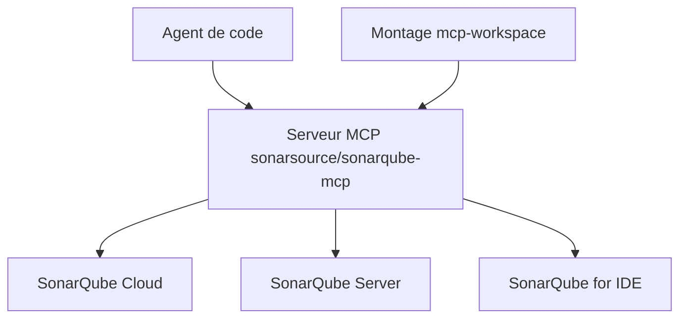

# SonarSource/sonarqube-mcp-server

> MCP server that gives a coding agent access to SonarQube Server or Cloud: code quality and security.

## The problem
Coding agents write code without seeing the quality and security problems that SonarQube has already spotted.

## What it actually does
Exposes to the agent tools to search and handle issues, security hotspots, quality gates, rules, coverage and duplications. Analyzes a code snippet locally or via the "Vortex" analysis. Toolsets are enabled on demand to limit context.

## How it is wired


## Trying it
```bash
claude mcp add sonarqube \
  --env SONARQUBE_TOKEN=$SONAR_TOKEN \
  --env SONARQUBE_ORG=$SONAR_ORG \
  -- docker run --init --pull=always -i --rm -e SONARQUBE_TOKEN -e SONARQUBE_ORG sonarsource/sonarqube-mcp
```

## Cost and gotchas
Requires Docker and a SonarQube token: never put it in plain text in the shell history. A SonarQube Cloud account or a server is needed. Each enabled tool adds context to every conversation.

## What it is not
Not a standalone analyzer: it relies on a SonarQube instance. Some advanced analyses require organization entitlement.

## Alternatives
No alternative cited in the README.

## For you
Adopt if your team already uses SonarQube: it puts code quality in the agent's loop, and comes from the vendor itself; check the license, not identified by GitHub.
