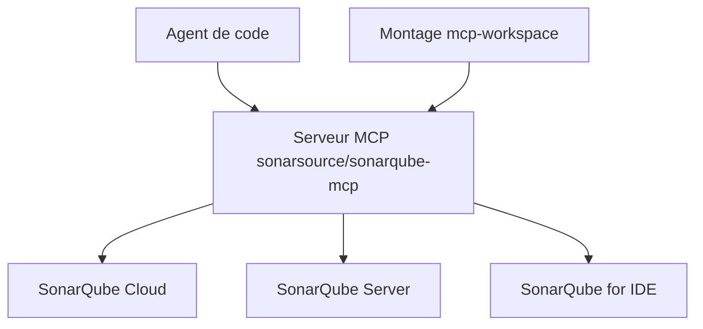

# SonarSource/sonarqube-mcp-server

> Serveur MCP qui donne à un agent de code l'accès à SonarQube Server ou Cloud : qualité et sécurité du code.

## Le problème
Les agents de code écrivent du code sans voir les problèmes de qualité et de sécurité que SonarQube a déjà repérés.

## Ce que ça fait vraiment
Expose à l'agent des outils pour chercher et traiter les issues, les points chauds de sécurité, les portes qualité, les règles, la couverture et les duplications. Analyse un extrait de code localement ou via l'analyse « Vortex ». Les jeux d'outils s'activent à la carte pour limiter le contexte.

## Comment c'est branché


## Essayer
```bash
claude mcp add sonarqube \
  --env SONARQUBE_TOKEN=$SONAR_TOKEN \
  --env SONARQUBE_ORG=$SONAR_ORG \
  -- docker run --init --pull=always -i --rm -e SONARQUBE_TOKEN -e SONARQUBE_ORG sonarsource/sonarqube-mcp
```

## Coût et pièges
Demande Docker et un jeton SonarQube : ne jamais le mettre en clair dans l'historique du shell. Un compte SonarQube Cloud ou un serveur est nécessaire. Chaque outil activé ajoute du contexte à chaque conversation.

## Ce que ce n'est pas
Pas un analyseur autonome : il s'appuie sur une instance SonarQube. Certaines analyses avancées exigent une habilitation de l'organisation.

## Alternatives
Aucune alternative citée dans le README.

## Pour toi
À adopter si ton équipe utilise déjà SonarQube : il met la qualité de code dans la boucle de l'agent, et vient de l'éditeur lui-même ; vérifie la licence, non identifiée par GitHub.

