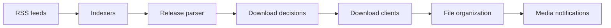

# Sonarr/Sonarr

> Personal video recorder for Usenet and BitTorrent: monitors TV series and downloads new episodes.

## The problem
Following series, finding new releases, downloading, renaming and filing them by hand is tedious.

## What it actually does
Tracks a library of series, reads indexer RSS feeds, applies a decision engine to pick a release, sends it to the download client (SABnzbd, NZBGet), then renames and files the results. Handles quality upgrades, failures (trying another release) and Kodi/Plex notifications. Web interface, REST API, SignalR.

## How it is wired

## Trying it
The README contains no commands: it points to the installation page, the FAQ and the wiki.

## Cost and gotchas
Free (GPL-3.0). Assumes indexers and download clients, often paid. Downloaded content is your own legal responsibility.

## What it is not
Does not download anything by itself: it orchestrates third-party indexers and clients. Not a playback application.

## Alternatives
No alternative named in the README.

## For you
Home media automation, unrelated to the data/AI trade: ignore.
