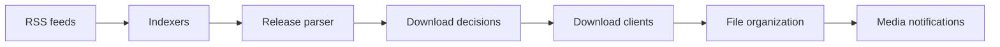

# Sonarr/Sonarr

> Enregistreur vidéo personnel pour Usenet et BitTorrent : surveille les séries et télécharge les nouveaux épisodes.

## Le problème
Suivre des séries, trouver de nouvelles sorties, les télécharger, les renommer et les ranger à la main est fastidieux.

## Ce que ça fait vraiment
Suit une bibliothèque de séries, lit des flux RSS d'indexeurs, applique un moteur de décision pour choisir une version, envoie au client de téléchargement (SABnzbd, NZBGet), puis renomme et range les fichiers. Gère les mises à niveau de qualité, les échecs (essai d'une autre version) et les notifications Kodi/Plex. Interface web, API REST, SignalR.

## Comment c'est branché

## Essayer
Le README ne contient aucune commande : il renvoie à la page d'installation, à la FAQ et au wiki.

## Coût et pièges
Gratuit (GPL-3.0). Suppose des indexeurs et des clients de téléchargement, souvent payants. Le contenu téléchargé relève de ta responsabilité légale.

## Ce que ce n'est pas
Ne télécharge rien seul : il orchestre des indexeurs et clients tiers. Pas une application de lecture.

## Alternatives
Aucune alternative nommée dans le README.

## Pour toi
Automatisation domestique de médias, sans lien avec le métier data/IA : à ignorer.

