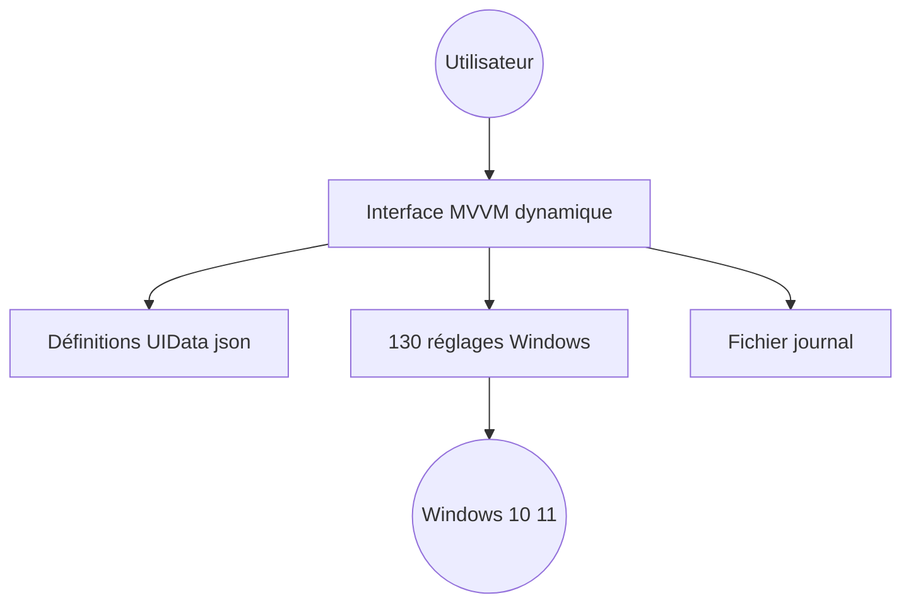

# Sophia-Community/SophiApp

> Windows 10/11 fine-tuning app: more than 130 privacy, interface and cleanup tweaks.

## The problem
Tuning Windows through official channels means digging through scattered registry keys, policies and menus.

## What it actually does
A dynamically generated interface shows the state of each setting (telemetry, personalization, security). It can uninstall OneDrive and UWP apps, install the Visual C++ and .NET redistributables, and schedule a Windows cleanup with notification. Built-in search, light or dark theme, a log to attach to tickets. Portable, no saved config.

## How it is wired
Simplified diagram based on the sheet, no diagram provided.



## Trying it
```powershell
irm app.sophi.app -useb | iex
choco install sophiapp --confirm
scoop bucket add extras
scoop install sophiapp
```

## Cost and gotchas
Free. The README advises against version 1.0.97 (deprecated) while waiting for SophiApp 2.0. Works poorly on "tinkered" Windows. Installing via `irm | iex` runs a remote script.

## What it is not
Not a cross-platform tool nor related to AI. It is not the final version: the README announces a rewrite (2.0, Daria).

## Alternatives
No alternative named in the README.

## For you
Ignore: Windows tuning unrelated to a data/MLOps workstation, and the README itself points to a rewrite.
