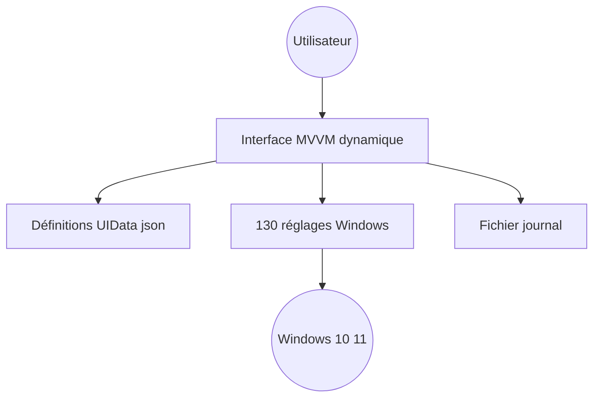

# Sophia-Community/SophiApp

> Application Windows 10/11 de réglage fin : plus de 130 tweaks de confidentialité, d'interface et de nettoyage.

## Le problème
Régler Windows par les voies officielles demande de fouiller registre, stratégies et menus dispersés.

## Ce que ça fait vraiment
Une interface générée dynamiquement affiche l'état de chaque réglage (télémétrie, personnalisation, sécurité). Elle sait désinstaller OneDrive et des apps UWP, installer les redistribuables Visual C++ et .NET, et planifier un nettoyage Windows avec notification. Recherche intégrée, thème clair ou sombre, journal à joindre aux tickets. Portable, sans config enregistrée.

## Comment c'est branché
Schéma simplifié d'après la fiche, sans diagramme fourni.



## Essayer
```powershell
irm app.sophi.app -useb | iex
choco install sophiapp --confirm
scoop bucket add extras
scoop install sophiapp
```

## Coût et pièges
Gratuit. Le README déconseille la version 1.0.97 (dépréciée) en attendant SophiApp 2.0. Fonctionne mal sur Windows « bricolé ». Une installation par `irm | iex` exécute un script distant.

## Ce que ce n'est pas
Pas un outil multiplateforme ni lié à l'IA. Ce n'est pas la version finale : le README annonce une refonte (2.0, Daria).

## Alternatives
Aucune alternative nommée dans le README.

## Pour toi
À ignorer : réglage de Windows sans lien avec un poste data/MLOps, et le README pointe lui-même vers une refonte.

