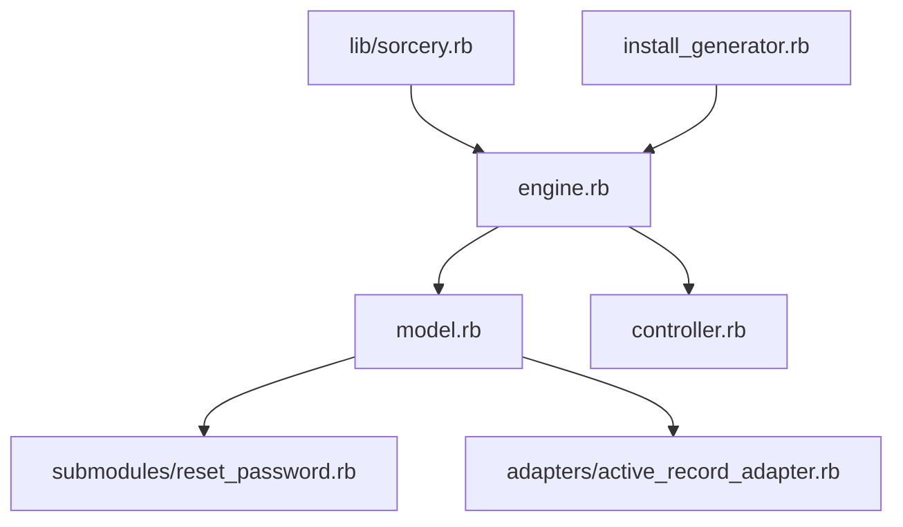

# Sorcery/sorcery

> Minimalist authentication library for Rails, which lets you write your own flow.

## The problem
Ready-made authentication solutions impose their generated code and views, which are hard to modify.

## What it actually does
Provides fewer than twenty public methods and activatable submodules: email activation, password reset, remember me, session timeout, brute-force protection, HTTP Basic, activity log, external OAuth (Twitter, Facebook, Github, Google...). bcrypt encryption by default. Installation generator.

## How it is wired


## Trying it
```bash
gem install sorcery
rails generate sorcery:install
rails generate sorcery:install remember_me reset_password
```

## Cost and gotchas
Free. You have to write controllers and views yourself. Rails only.

## What it is not
Not a Devise: no generated code or ready-made interface. Not an identity provider.

## Alternatives
Devise and Authlogic, cited as inspirations; Restful Authentication as well.

## For you
Ignore: Rails authentication, outside your data/AI profile.
