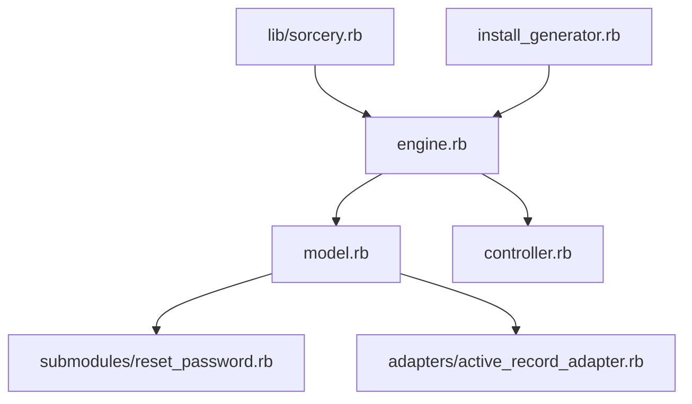

# Sorcery/sorcery

> Bibliothèque d'authentification minimaliste pour Rails, qui te laisse écrire ton propre flux.

## Le problème
Les solutions d'authentification toutes faites imposent leur code généré et leurs vues, difficiles à modifier.

## Ce que ça fait vraiment
Fournit moins de vingt méthodes publiques et des sous-modules activables : activation par email, réinitialisation de mot de passe, remember me, délai de session, protection contre la force brute, HTTP Basic, journal d'activité, OAuth externe (Twitter, Facebook, Github, Google...). Chiffrement bcrypt par défaut. Générateur d'installation.

## Comment c'est branché


## Essayer
```bash
gem install sorcery
rails generate sorcery:install
rails generate sorcery:install remember_me reset_password
```

## Coût et pièges
Gratuit. Il faut écrire soi-même contrôleurs et vues. Réservé à Rails.

## Ce que ce n'est pas
Pas un Devise : pas de code généré ni d'interface prête. Pas un fournisseur d'identité.

## Alternatives
Devise et Authlogic, cités comme inspirations ; Restful Authentication aussi.

## Pour toi
Ignorer : authentification Rails, hors de ton profil data/IA.

