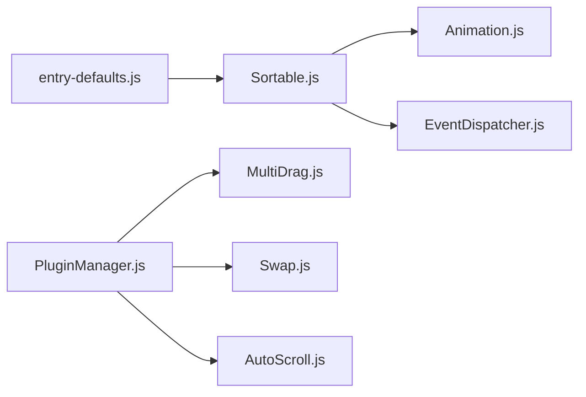

# SortableJS/Sortable

> JavaScript library for drag-and-drop reorderable lists, for front-end developers.

## The problem
Native HTML5 drag and drop is painful to handle: touch, animations, multiple lists, auto-scrolling.

## What it actually does
Creates a `Sortable` object on a DOM list: moving within a list or between lists (`group`, `pull`, `put`), cloning, handle, filter, CSS animations, touch, no jQuery. AutoScroll and OnSpill plugins (default), MultiDrag and Swap (extras). The order can be saved via `store`; events (`onEnd`, `onUpdate`, `onSort`…) notify changes. Cited integrations: React, Vue, Angular, Meteor, Knockout, Polymer, Ember.

## How it is wired


## Trying it
```bash
npm install sortablejs --save
```
```js
var el = document.getElementById('items');
var sortable = Sortable.create(el);
```

## Cost and gotchas
Free. The README flags limits: `delay` is impossible with native drag and drop on IE/Edge; `touchStartThreshold` needs tuning on some very sensitive phones.

## What it is not
It is not a ready-to-use component with an interface: it only handles the reordering behavior; data and persistence remain your responsibility.

## Alternatives
- html5sortable (voidberg): cited in the README, which Sortable claims to outperform on text selection.

## For you
Adopt if you are building an annotation tool or a web dashboard: small, stable building block, MIT, no mandatory dependency.
