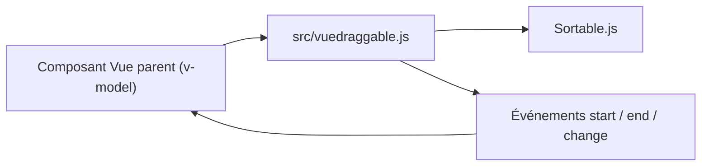

# SortableJS/Vue.Draggable

> Vue 2 drag-and-drop component, synchronized with an array, based on Sortable.js.

## The problem
Reorder lists by drag and drop while keeping Vue's data model synchronized with the DOM.

## What it actually does
The `draggable` component wraps Sortable.js and binds to an array through `v-model` or `list`. It handles cross-list dragging, handles, touch, cloning, header and footer slots, `transition-group`, Vuex and wrapping components from other libraries (via `tag` and `componentData`). It emits Sortable events and a `change` event.

## How it is wired


## Trying it
```bash
yarn add vuedraggable
npm i -S vuedraggable
```

## Cost and gotchas
Free. Targets Vue 2; the README points to `vue.draggable.next` for Vue 3. Last push on 2024-03-04, more than a year ago. Do not confuse `vuedraggable` (Vue 2) with `vue-draggable` (Vue 1). `v-for` keys must reflect the content, not the index.

## What it is not
Not a version for Vue 3. Header and footer slots do not work with `transition-group`.

## Alternatives
`vue.draggable.next` for Vue 3 (named in the README).

## For you
Ignore: an old Vue 2 component unrelated to data or AI; if the need arises in Vue 3, use the dedicated version.
