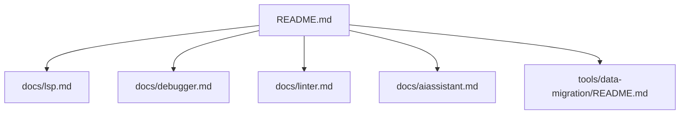

# SpartanJ/ecode

> Lightweight, fast, cross-platform, hardware-accelerated code editor for developers.

## The problem
Modern editors are heavy at startup and consume a lot of resources.

## What it actually does
It offers highlighting for more than 100 languages, multi-cursors, LSP, DAP debugging, Git, terminal, command palette, completion, configurable linters and formatters, global search and an AI assistant plugin with ACP support. Built on the eepp graphics library; versions for macOS, Windows, Linux, FreeBSD, Haiku, and a WASM demo.

## How it is wired
The repository only contains documentation; the code is in eepp.

## Trying it
No command is given for usage; to build, `build.app.sh` per platform, and `make ecode` on the eepp side.

## Cost and gotchas
Free. Source code and pull requests go to the eepp repository, not here. The AI assistant requires a model or key of your choice. Little tested on Windows.

## What it is not
Not a Vim-mode editor, nor a stable replacement for critical use: the author says so.

## Alternatives
The README cites lite, lite-xl, QtCreator and Sublime Text as inspirations.

## For you
Worth watching: a lightweight editor of interest if VS Code weighs on you, but the code is elsewhere and the project rests on one person.
