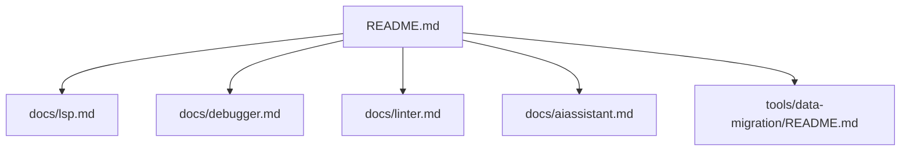

# SpartanJ/ecode

> Éditeur de code léger et rapide, multiplateforme, accéléré matériellement, pour développeurs.

## Le problème
Les éditeurs modernes sont lourds au démarrage et consomment beaucoup de ressources.

## Ce que ça fait vraiment
Il offre coloration pour plus de 100 langages, multi-curseurs, LSP, débogage DAP, Git, terminal, palette de commandes, complétion, linters et formateurs configurables, recherche globale et un plugin d'assistant IA avec support ACP. Construit sur la bibliothèque graphique eepp ; versions macOS, Windows, Linux, FreeBSD, Haiku, et démo WASM.

## Comment c'est branché
Le dépôt ne contient que la documentation ; le code est dans eepp.

## Essayer
Aucune commande n'est donnée pour l'usage ; pour compiler, `build.app.sh` par plateforme, et `make ecode` côté eepp.

## Coût et pièges
Gratuit. Le code source et les pull requests vont dans le dépôt eepp, pas ici. L'assistant IA demande un modèle ou une clé de ton choix. Peu testé sous Windows.

## Ce que ce n'est pas
Ce n'est pas un éditeur à mode Vim, ni un remplaçant stable pour un usage critique : l'auteur le dit.

## Alternatives
Le README cite lite, lite-xl, QtCreator et Sublime Text comme inspirations.

## Pour toi
À surveiller : éditeur léger intéressant si VS Code te pèse, mais le code est ailleurs et le projet repose sur une personne.

