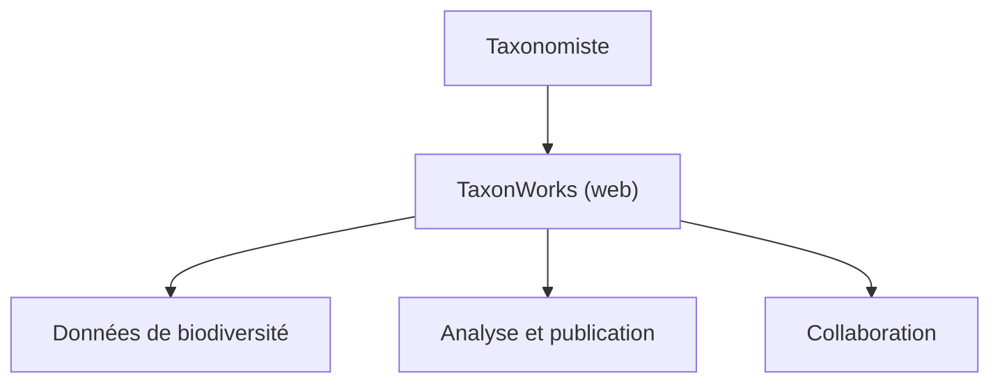

# SpeciesFileGroup/taxonworks

> Web workbench for taxonomists and biodiversity researchers: enter, organize and publish their data.

## The problem
Taxonomists manage names, specimens and publications across scattered tools.

## What it actually does
The README is short: a web application to capture, organize and enrich data, collaborate, and prepare analysis and publication. Details are deferred to the taxonworks.org and docs.taxonworks.org sites. Funded by a Species File Group endowment and by the NSF.

## How it is wired
Simplified diagram based on the sheet, no diagram provided.



## Trying it
```bash
# aucune commande documentée : voir docs.taxonworks.org
```

## Cost and gotchas
Free. Architecture and technology stack are not documented in the README; more than 800 open issues.

## What it is not
Not a general-purpose data tool: built for taxonomy.

## Alternatives
No alternative named in the README.

## For you
Ignore: biodiversity domain, unrelated to your data / AI / MLOps profile.
