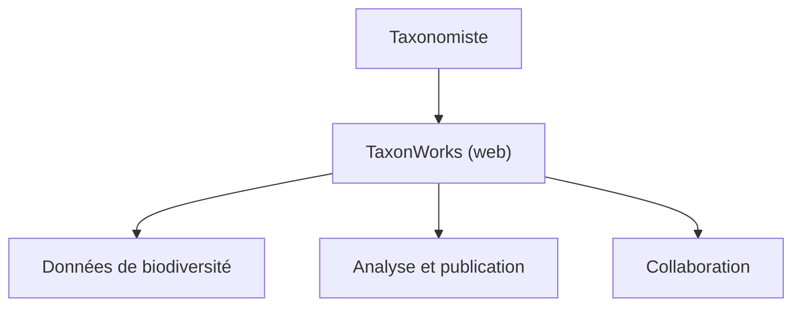

# SpeciesFileGroup/taxonworks

> Atelier web pour taxonomistes et chercheurs en biodiversité : saisir, organiser et publier leurs données.

## Le problème
Les taxonomistes gèrent noms, spécimens et publications dans des outils dispersés.

## Ce que ça fait vraiment
Le README est court : application web pour capturer, organiser et enrichir des données, collaborer et préparer l'analyse et la publication. Le détail est renvoyé aux sites taxonworks.org et docs.taxonworks.org. Financé par une dotation du Species File Group et par la NSF.

## Comment c'est branché
Schéma simplifié d'après la fiche, sans diagramme fourni.



## Essayer
```bash
# aucune commande documentée : voir docs.taxonworks.org
```

## Coût et pièges
Gratuit. Architecture et pile technique non documentées dans le README ; plus de 800 issues ouvertes.

## Ce que ce n'est pas
Pas un outil généraliste de données : conçu pour la taxonomie.

## Alternatives
Aucune alternative nommée dans le README.

## Pour toi
Ignorer : domaine de la biodiversité, sans lien avec ton profil data / IA / MLOps.

