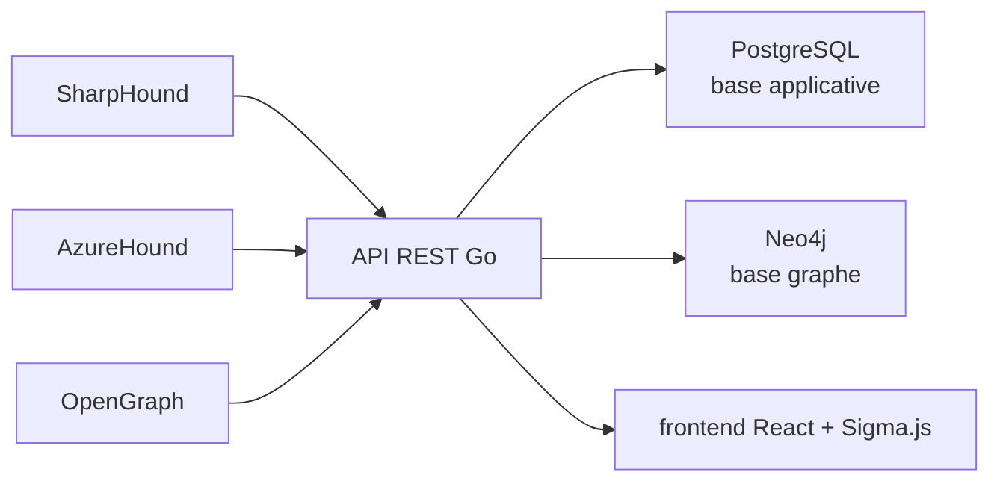

# SpecterOps/BloodHound

> Web application that maps a directory's privilege paths as a graph, for red and blue teams.

## The problem
Privilege relationships in Active Directory, Azure or another IAM are invisible to the naked eye.
An attack path four hops long is impossible to find manually.

## What it actually does
Embedded React frontend (Sigma.js) and Go REST API, on a PostgreSQL application database and a Neo4j graph.
The data comes from the SharpHound and AzureHound collectors.
OpenGraph extends the analysis beyond AD and Azure, to other identity platforms.
Attackers find paths there; defenders find what to fix.

## How it is wired

## Trying it
No command in the README: it points to the Community Edition Quickstart and a Docker Compose example.

## Cost and gotchas
BloodHound CE is free under Apache-2.0; BloodHound Enterprise is the paid product from the same vendor.
You must run PostgreSQL and Neo4j, and collect directory data — sensitive by nature.

## What it is not
It is not a vulnerability scanner or an exploitation tool: it reveals relationships.
It is not single-file — it is a monolithic application with two databases.
The collector is not in this repository.

## Alternatives
None named; only BloodHound Enterprise, the commercial version, is cited.

## For you
Unrelated to a data pipeline; worth remembering if you have to audit your directory's privileges.
