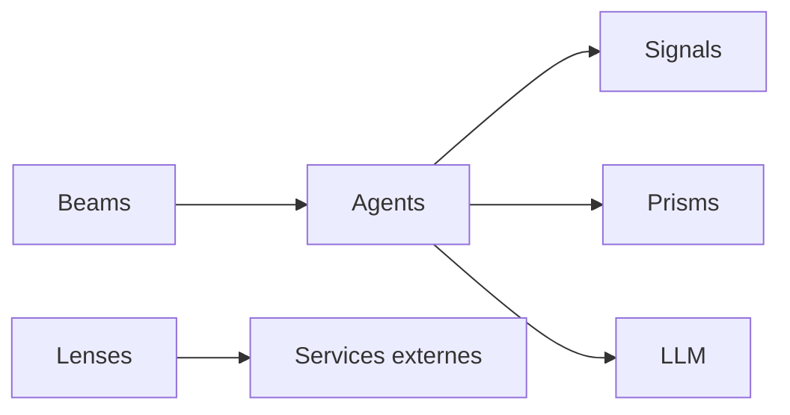

# Spectral-Finance/lux

> Language-agnostic multi-agent framework, with LLMs, orchestrated workflows and self-reflecting agents.

## The problem
Coordinating several AI agents with typed messages and composable flows.

## What it actually does
Concepts: agents, signals (typed schemas), prisms (functional components), beams (workflow orchestration) and lenses (external services). Examples: crypto trading system, content pipeline. Codespaces environment with Elixir, Python and Livebook. Self-improvement is "coming soon".

## How it is wired


## Trying it
```bash
chmod +x scripts/setup-codespace-ssh.sh
./scripts/setup-codespace-ssh.sh
```
(for Cursor on Codespaces).

## Cost and gotchas
LLM keys at your expense. Last push in December 2025, 562 open issues.

## What it is not
Not yet autonomous: reflection and self-improvement not delivered. "Language agnostic": the README shows no code.

## Alternatives
No alternative named in the README.

## For you
Worth watching: ideas for agent composition, but many issues, little recent activity and unfulfilled promises in the README.
