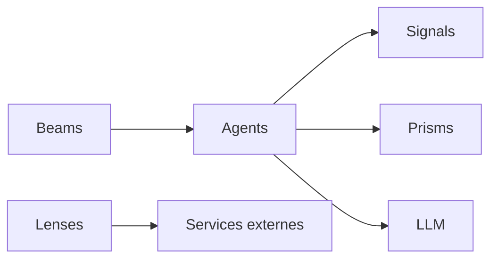

# Spectral-Finance/lux

> Framework multi-agents indépendant du langage, avec LLM, workflows orchestrés et agents qui se réfléchissent.

## Le problème
Coordonner plusieurs agents IA avec des messages typés et des flux composables.

## Ce que ça fait vraiment
Concepts : agents, signaux (schémas typés), prismes (composants fonctionnels), faisceaux (orchestration de workflow) et lentilles (services externes). Exemples : système de trading crypto, pipeline de contenu. Environnement Codespaces avec Elixir, Python et Livebook. L'auto-amélioration est « coming soon ».

## Comment c'est branché


## Essayer
```bash
chmod +x scripts/setup-codespace-ssh.sh
./scripts/setup-codespace-ssh.sh
```
(pour Cursor sur Codespaces).

## Coût et pièges
Clés LLM à ta charge. Dernier push en décembre 2025, 562 issues ouvertes.

## Ce que ce n'est pas
Pas encore autonome : réflexion et auto-amélioration non livrées. « Language agnostic » : le README ne montre pas de code.

## Alternatives
Aucune alternative nommée dans le README.

## Pour toi
À surveiller : idées de composition d'agents, mais beaucoup d'issues, peu d'activité récente et promesses non tenues dans le README.

