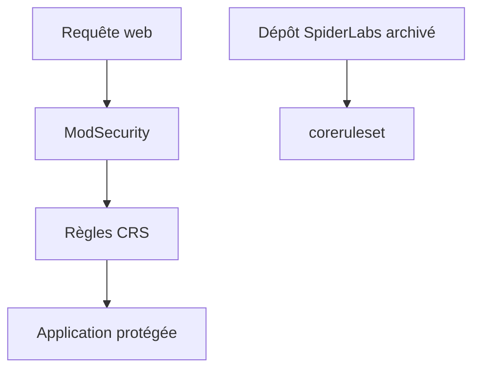

# SpiderLabs/owasp-modsecurity-crs

> Former repository of the OWASP CRS generic rules for ModSecurity, archived: the project has moved.

## The problem
Protecting a web application from common attacks without writing the web application firewall rules yourself.

## What it actually does
The repository now only contains the migration notice: the project now lives at coreruleset/coreruleset. The generic rule set targets the OWASP Top Ten with few false alerts, for ModSecurity or a compatible firewall.

## How it is wired
Simplified diagram based on the fiche, no diagram provided.

## Trying it
No documented command: follow the link to the OWASP CRS page.

## Cost and gotchas
Free. Archived repository, last commit in 2020, unmaintained: do not use it, go to coreruleset/coreruleset.

## What it is not
Not an offensive tool: it is a defensive rule set. Not a living repository.

## Alternatives
coreruleset/coreruleset, the project's new home.

## For you
Ignore: archived since 2020; if you protect a model API, look at the coreruleset repository instead.
