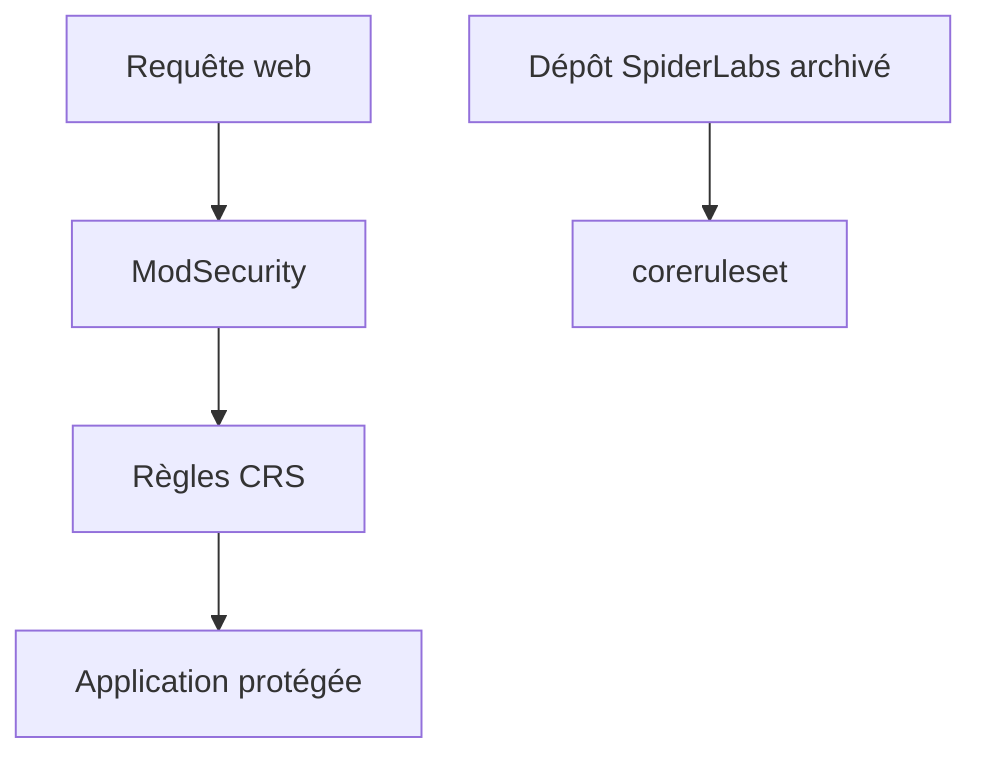

# SpiderLabs/owasp-modsecurity-crs

> Ancien dépôt des règles génériques OWASP CRS pour ModSecurity, archivé : le projet a déménagé.

## Le problème
Protéger une application web des attaques courantes sans écrire soi-même les règles du pare-feu applicatif.

## Ce que ça fait vraiment
Le dépôt ne contient plus que l'avis de migration : le projet vit désormais sur coreruleset/coreruleset. Le jeu de règles génériques vise l'OWASP Top Ten avec peu de fausses alertes, pour ModSecurity ou un pare-feu compatible.

## Comment c'est branché
Schéma simplifié d'après la fiche, sans diagramme fourni.

## Essayer
Aucune commande documentée : suivre le lien vers la page OWASP CRS.

## Coût et pièges
Gratuit. Dépôt archivé, dernier commit en 2020, non maintenu : ne pas l'utiliser, aller sur coreruleset/coreruleset.

## Ce que ce n'est pas
Pas un outil offensif : c'est un jeu de règles défensif. Pas un dépôt vivant.

## Alternatives
coreruleset/coreruleset, nouvelle maison du projet.

## Pour toi
À ignorer : archivé depuis 2020 ; si tu protèges une API de modèle, regarde le dépôt coreruleset à la place.

