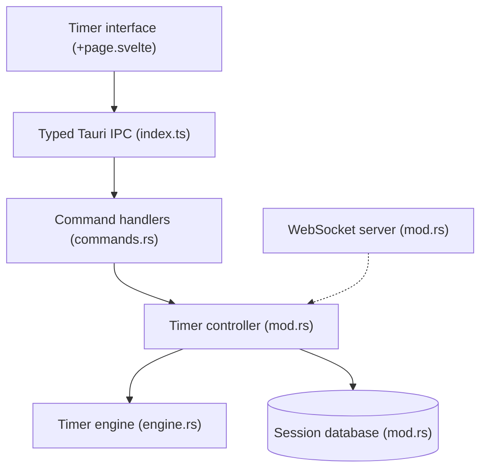

# Splode/pomotroid

> Configurable desktop Pomodoro timer, for those who want to track their work time with statistics.

## The problem
Tracking work/break cycles without a dedicated tool is done by hand, with no history or sound reminder.

## What it actually does
Desktop timer (Tauri 2, Rust, Svelte 5) with adjustable durations and number of rounds. It records each session and shows day and week views and a 52-week heatmap. It offers 38 themes, 8 languages, global shortcuts, a system tray icon and notifications. A local WebSocket server, disabled by default, exposes the timer state.

## How it is wired


## Trying it
```bash
brew install --cask pomotroid
# ou depuis les sources
npm install
npm run tauri dev
npm run tauri build
```

## Cost and gotchas
Free, no key. The application is not signed: a warning appears on first launch. On GNOME, the system tray icon requires an extension.

## What it is not
It is not a team tool nor a task manager. The WebSocket server is for stream overlays, not for synchronization between machines.

## Alternatives
No alternative named in the README.

## For you
Ignore: a personal timer unrelated to data or MLOps pipelines, useful only if you want a desktop Pomodoro.
