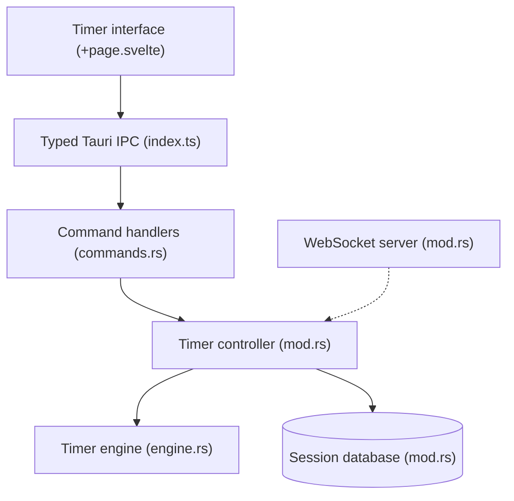

# Splode/pomotroid

> Minuteur Pomodoro de bureau configurable, pour qui veut suivre son temps de travail avec des statistiques.

## Le problème
Suivre ses cycles travail/pause sans outil dédié se fait à la main, sans historique ni rappel sonore.

## Ce que ça fait vraiment
Minuteur de bureau (Tauri 2, Rust, Svelte 5) avec durées et nombre de tours réglables. Il enregistre chaque session et affiche des vues jour, semaine et une carte de chaleur sur 52 semaines. Il propose 38 thèmes, 8 langues, des raccourcis globaux, une icône de barre système et des notifications. Un serveur WebSocket local, désactivé par défaut, expose l'état du minuteur.

## Comment c'est branché


## Essayer
```bash
brew install --cask pomotroid
# ou depuis les sources
npm install
npm run tauri dev
npm run tauri build
```

## Coût et pièges
Gratuit, aucune clé. L'application n'est pas signée : un avertissement apparaît au premier lancement. Sous GNOME, l'icône de barre système demande une extension.

## Ce que ce n'est pas
Ce n'est pas un outil d'équipe ni un gestionnaire de tâches. Le serveur WebSocket sert aux overlays de stream, pas à de la synchronisation entre machines.

## Alternatives
Aucune alternative nommée dans le README.

## Pour toi
À ignorer : un minuteur personnel sans lien avec les pipelines data ou MLOps, utile seulement si tu cherches un Pomodoro de bureau.

