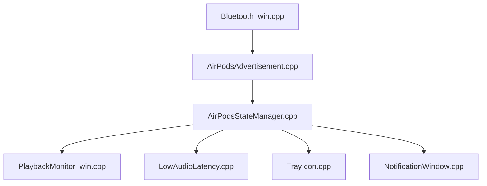

# SpriteOvO/AirPodsDesktop

> A Windows application that brings AirPods battery, ear detection and low latency to PC.

## The problem
AirPods show neither battery level nor automatic pause on Windows.

## What it actually does
It decodes the AirPods' Bluetooth Low Energy advertisements, aggregates the state (battery, ears) and drives media playback. It offers a low audio latency mode and animated notification windows in the notification area, with light, dark or system themes.

## How it is wired


## Trying it
```bash
# Aucune commande dans ce README : voir les Build Instructions liées pour les prérequis Windows.
```

## Cost and gotchas
Free, GPL-3.0. Windows 10 1809 or later, x64 only; no 32-bit or ARM64. The build uses Qt 6.8.3.

## What it is not
Not a macOS or Linux application, nor an official Apple tool. AirPods Pro of every generation are not listed one by one.

## Alternatives
- MagicPods: cited in the credits, an equivalent paid application.
- OpenPods: cited in the credits, the original project for BLE reading.

## For you
Ignore: a mainstream Windows utility, with no link to data, AI or MLOps work.
