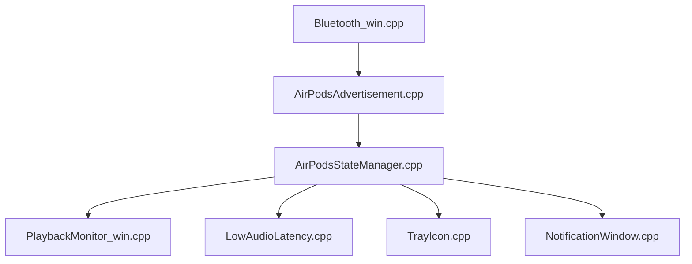

# SpriteOvO/AirPodsDesktop

> Application Windows qui apporte batterie, détection d'oreille et faible latence des AirPods sur PC.

## Le problème
Les AirPods n'affichent ni niveau de batterie ni pause automatique sous Windows.

## Ce que ça fait vraiment
Elle décode les annonces Bluetooth Low Energy des AirPods, agrège l'état (batterie, oreilles) et pilote la lecture média. Elle propose un mode faible latence audio et des fenêtres de notification animées dans la zone de notification, avec thèmes clair, sombre ou système.

## Comment c'est branché


## Essayer
```bash
# Aucune commande dans ce README : voir les Build Instructions liées pour les prérequis Windows.
```

## Coût et pièges
Gratuit, GPL-3.0. Windows 10 1809 ou plus, en x64 uniquement ; ni 32 bits ni ARM64. Le build utilise Qt 6.8.3.

## Ce que ce n'est pas
Pas une application macOS ou Linux, ni un outil officiel d'Apple. Les AirPods Pro de toute génération ne sont pas listés un par un.

## Alternatives
- MagicPods : cité en crédits, application payante équivalente.
- OpenPods : cité en crédits, projet d'origine pour la lecture BLE.

## Pour toi
À ignorer : un utilitaire Windows grand public, sans lien avec un travail data, IA ou MLOps.

