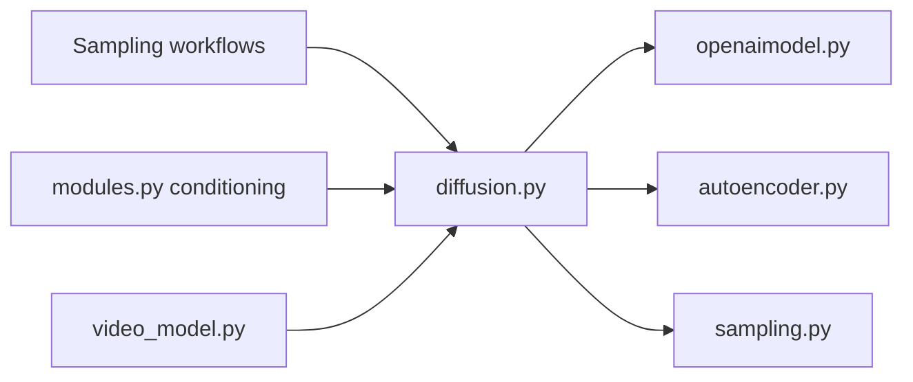

# Stability-AI/generative-models

> Config-driven code to train and sample diffusion models (SDXL, SV3D, SV4D), for researchers.

## The problem
Assembling a diffusion model (network, conditioning, loss, sampler) by hand is slow and hard to reproduce.

## What it actually does
Each module is instantiated via `instantiate_from_config()` from yaml files in `configs/`. The repository provides a Streamlit demo (`scripts/demo/sampling.py`) for SDXL, training via `main.py --base`, an invisible watermark detector, and image-to-video SV3D and video-to-4D SV4D/SV4D 2.0 workflows (according to the described architecture). The SDXL-1.0 weights are under the CreativeML Open RAIL++-M license, those of SDXL-0.9 under a research license.

## How it is wired


## Trying it
```bash
git clone https://github.com/Stability-AI/generative-models.git
cd generative-models
python3 -m venv .pt2
source .pt2/bin/activate
pip3 install torch torchvision torchaudio --index-url https://download.pytorch.org/whl/cu118
pip3 install -r requirements/pt2.txt
pip3 install .
streamlit run scripts/demo/sampling.py --server.port <your_port>
```

## Cost and gotchas
GPU required; tested on Python 3.10. Weights are downloaded from Hugging Face (access on request for 0.9). The package does not declare its dependencies.

## What it is not
It is not a ready-to-use service: no weights included in the repository. The code is MIT, but the weights have their own licenses.

## Alternatives
Not documented: the README does not name an alternative.

## For you
Watch: useful for understanding a configurable diffusion architecture, but last push in December 2025 and weights under separate licenses to read before use.
