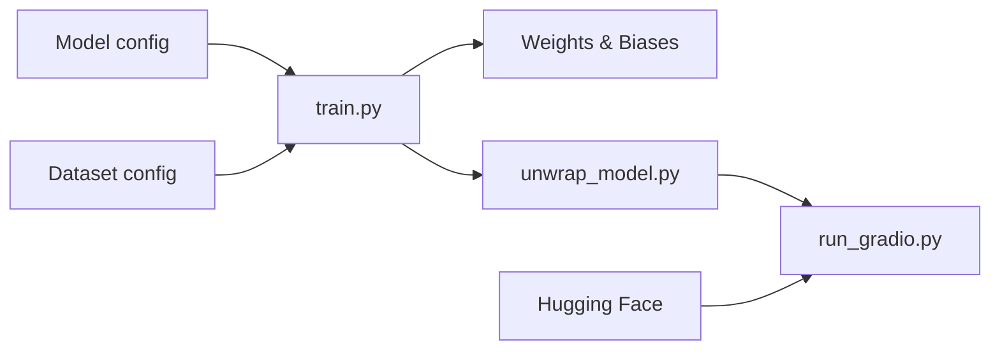

# Stability-AI/stable-audio-tools

> Training and inference code for audio generation models, for audio researchers and engineers.

## The problem
Training or fine-tuning audio models (autoencoders, diffusion) requires a lot of configuration plumbing.

## What it actually does
Driven by JSON files (model, dataset): `train.py` launches multi-GPU PyTorch Lightning training, `unwrap_model.py` strips the training wrapper, `run_gradio.py` serves a demo. Local datasets or WebDataset on S3, Weights & Biases tracking.

## How it is wired


## Trying it
```bash
git clone https://github.com/Stability-AI/stable-audio-tools.git
cd stable-audio-tools
uv sync --extra train --extra ui
uv run python run_gradio.py --pretrained-name stabilityai/stable-audio-open-1.0
```

## Cost and gotchas
PyTorch ≥ 2.5, Flash Attention recommended. A Weights & Biases account is required for training; model terms must be accepted on Hugging Face.

## What it is not
Not a turnkey product: troubleshooting and contribution sections are still to be written.

## Alternatives
- No alternative cited in the README.

## For you
Worth watching: a solid base if you do generative audio; otherwise irrelevant.
