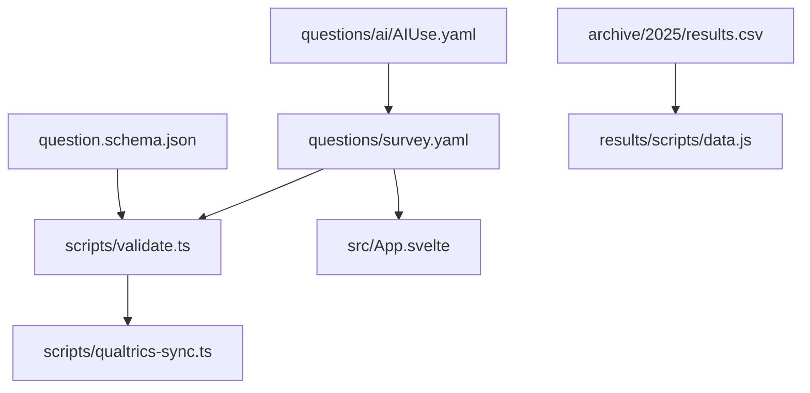

# StackExchange/Survey

> Question bank and YAML flow of the annual Stack Overflow survey, opened to the community.

## The problem
The questionnaire of a large survey is opaque: you can see neither the wording, the order, nor possible biases.

## What it actually does
The questions are YAML files, the flow is in `questions/survey.yaml`. A Svelte tool previews and validates the survey, then syncs it to Qualtrics. The repository also contains the results site and the archive of past years (results, schemas, PDFs).

## How it is wired
Diagram based on the code diagram.



## Trying it
```bash
npm install
npm run dev -w survey
npm run validate -w survey
npm run dev -w results
```

## Cost and gotchas
Free. Node and npm required. The Qualtrics sync assumes an account and Stack Overflow's access.

## What it is not
Not a generic survey tool: it is the instrument of one specific survey, whose final content Stack Overflow alone decides.

## Alternatives
None cited in the README.

## For you
Keep an eye on it: the archived results (CSV) serve as data on developer practices and AI usage, the rest is specific.
