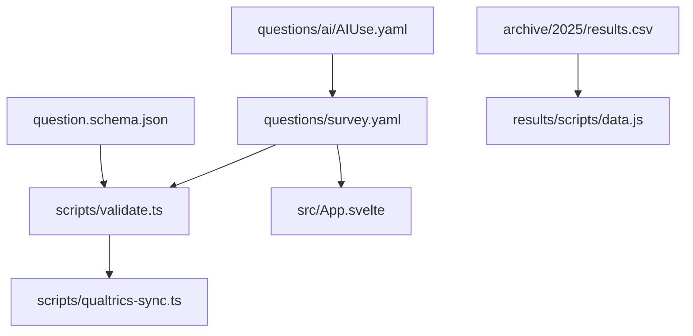

# StackExchange/Survey

> Banque de questions et flux YAML du sondage annuel Stack Overflow, ouverts à la communauté.

## Le problème
Le questionnaire d'un grand sondage est opaque : on ne voit ni la formulation, ni l'ordre, ni les biais éventuels.

## Ce que ça fait vraiment
Les questions sont des fichiers YAML, le flux est dans `questions/survey.yaml`. Un outil Svelte prévisualise et valide le sondage, puis le synchronise vers Qualtrics. Le dépôt contient aussi le site des résultats et l'archive des années passées (résultats, schémas, PDF).

## Comment c'est branché
Schéma d'après le diagramme du code.



## Essayer
```bash
npm install
npm run dev -w survey
npm run validate -w survey
npm run dev -w results
```

## Coût et pièges
Gratuit. Node et npm requis. La synchronisation Qualtrics suppose un compte et l'accès de Stack Overflow.

## Ce que ce n'est pas
Pas un outil de sondage générique : c'est l'instrument d'un sondage précis, dont Stack Overflow décide seul du contenu final.

## Alternatives
Aucune citée dans le README.

## Pour toi
Surveiller : les résultats archivés (CSV) servent de données sur les pratiques des développeurs et l'usage de l'IA, le reste est spécifique.

