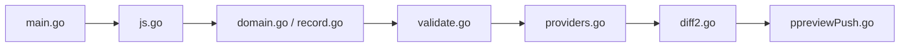

# StackExchange/dnscontrol

> Infrastructure as code for DNS: describe zones in JavaScript and push them to several providers.

## The problem
Changing DNS through web portals or BIND files is error-prone and hard to reproduce.

## What it actually does
Reads `dnsconfig.js`, computes the differences with each provider (`preview`), then applies them (`push`). The same set of records can go to several providers (Route 53, Cloudflare, Gandi…), with variables, macros and transformations. `dnscontrol init` generates a starter configuration. Runs anywhere Go runs, and in a container.

## How it is wired


## Trying it
```bash
docker run --rm -it -v "$(pwd):/dns"  ghcr.io/dnscontrol/dnscontrol preview
```
The README also mentions `dnscontrol init` and `dnscontrol push`.

## Cost and gotchas
Free. The NAMEDOTCOM, OPENSRS and SOFTLAYER providers no longer have a maintainer. A breaking change to `REV()` (RFC2317 to RFC4183) is announced after v5.0.

## What it is not
Not a DNS server: it configures external providers through their APIs.

## Alternatives
No alternative mentioned in the README.

## For you
Ignore unless you manage DNS zones yourself: a good tool, but outside the data/AI scope.
