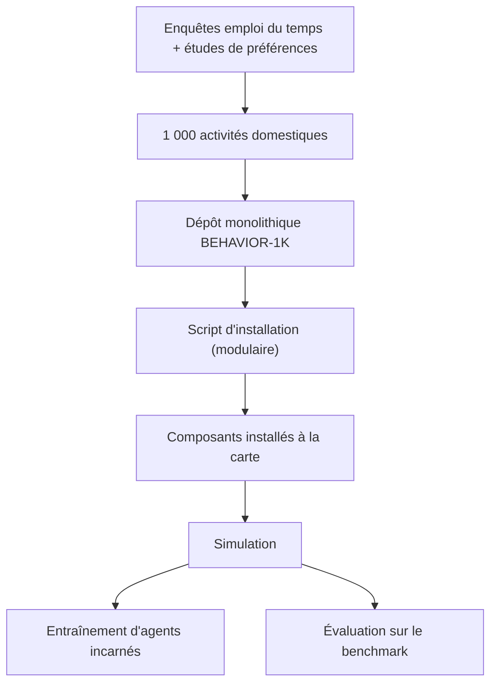

# StanfordVL/BEHAVIOR-1K

> Simulation benchmark covering 1,000 household activities for embodied agents.

## The problem
Evaluating an embodied agent on realistic tasks requires a simulator, scenes, objects and consistent task definitions — and everyone rewrites an incompatible version of them.

## What it actually does
The README is only a few lines long. It presents a monolithic repository providing everything needed to train and evaluate agents on a thousand everyday activities such as cleaning, cooking and tidying. The notable point is where the tasks come from: they are selected from real surveys on how people spend their time and from preference studies, not picked arbitrarily by the authors. Installation goes through a provided script that handles all dependencies and components, with a modular install that lets you install only what you need. The rest — task list, simulator, evaluation protocol — is deferred to the main website and the installation guide.

## How it is wired

## Trying it
The README gives no command: it only says that an installation script exists and points to the installation guide.

## Cost and gotchas
Free. An embodied simulation benchmark implies a GPU and a sizeable volume of assets, but the README gives no figures: no required hardware, no disk size, no run time. The modular install is the only lever mentioned for limiting the footprint.

## What it is not
This README is not enough to judge: insufficient material. It says nothing about the underlying simulator, the task format, the metrics, or the license. It is not a model nor a learning library — it is a test bench.

## Alternatives
- No alternative named in the README.

## For you
Open it only if you work on embodied AI; otherwise, nothing usable here.
