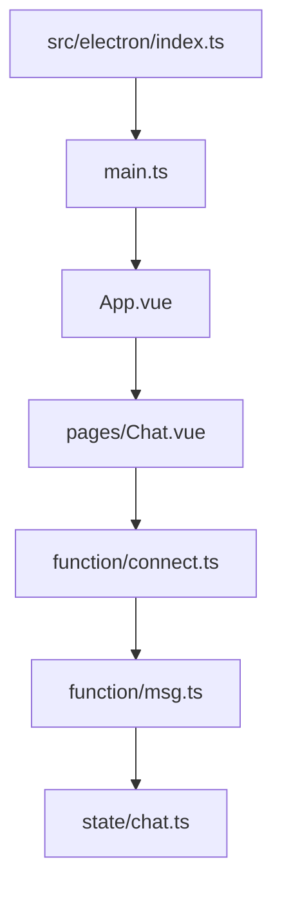

# Stapxs/Stapxs-QQ-Lite-2.0

> Unofficial web client for QQ, OneBot-compatible, with Electron, Tauri and mobile versions.

## The problem
Using QQ through a lightweight, adaptable web client connected to a OneBot-compatible QQ bot.

## What it actually does
A Vue interface (README in Chinese) that connects to a OneBot 11-compatible QQ backend, displays complex messages, group files and images, and handles light and dark modes. Available as a web page, Docker, `npx ssqq-web`, Electron, Tauri, Capacitor (Android and iOS) or a Napcat plugin.

## How it is wired


## Trying it
```bash
npx ssqq-web hostname=127.0.0.1 port=8081
docker pull ghcr.io/stapxs/stapxs-qq-lite-2.0:latest
yarn install
yarn dev
```

## Cost and gotchas
Free, but a QQ Bot backend that you deploy yourself is essential. Using a bot carries account-related risks. The default map API key has limited usage.

## What it is not
Not an official client: for "study and exchange" use only. Bots that are not OneBot 11 work poorly.

## Alternatives
- Stapxs QQ Lite X: community version with more features.
- Stapxs QQ Shell: to connect to Napcat from the terminal.

## For you
Ignore: an unofficial Chinese messaging client, unrelated to data, AI or MLOps work.
