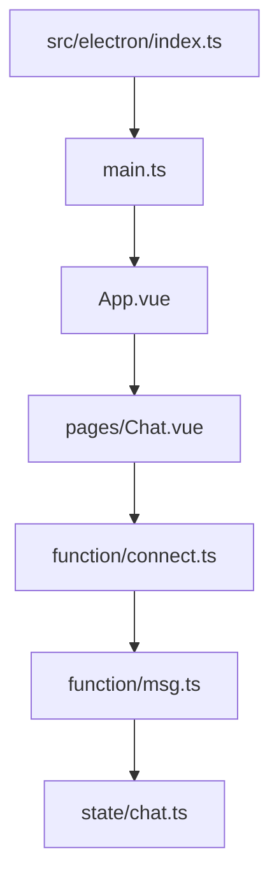

# Stapxs/Stapxs-QQ-Lite-2.0

> Client web non officiel pour QQ, compatible OneBot, avec versions Electron, Tauri et mobile.

## Le problème
Utiliser QQ via un client web léger et adaptable, connecté à un robot QQ compatible OneBot.

## Ce que ça fait vraiment
Une interface Vue (README en chinois) qui se connecte à un backend QQ compatible OneBot 11, affiche messages complexes, fichiers de groupe et images, et gère les modes clair et sombre. Disponible en page web, Docker, `npx ssqq-web`, Electron, Tauri, Capacitor (Android et iOS) ou plugin Napcat.

## Comment c'est branché


## Essayer
```bash
npx ssqq-web hostname=127.0.0.1 port=8081
docker pull ghcr.io/stapxs/stapxs-qq-lite-2.0:latest
yarn install
yarn dev
```

## Coût et pièges
Gratuit, mais un backend QQ Bot à déployer soi-même est indispensable. Utiliser un bot comporte des risques côté compte. Clé d'API de carte par défaut limitée en usage.

## Ce que ce n'est pas
Pas un client officiel : usage « d'étude et d'échange » seulement. Les bots non OneBot 11 fonctionnent mal.

## Alternatives
- Stapxs QQ Lite X : version communautaire avec plus de fonctions.
- Stapxs QQ Shell : pour se connecter à Napcat depuis le terminal.

## Pour toi
Ignorer : un client de messagerie chinois non officiel, sans rapport avec un travail data, IA ou MLOps.

