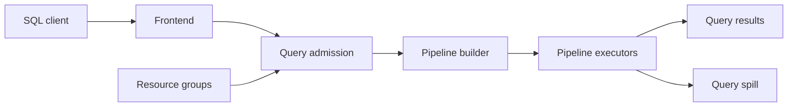

# StarRocks/starrocks

> Distributed analytical SQL engine for sub-second ad hoc queries, on warehouse or lakehouse.

## The problem
Slow multi-dimensional analytical queries force you to denormalize or to move data to another system.

## What it actually does
A SQL server compatible with the MySQL protocol: a Java frontend (parsing, CBO optimizer, admission) and vectorized C++ backends that execute in parallel pipelines. Reads Hive, Iceberg, Delta Lake and Hudi directly. Primary-key upsert/delete, materialized views, per-tenant resource groups. Shared-data mode since 3.0.

## How it is wired

## Trying it
No command in the README; it points to the Quick Starts on the documentation site.

## Cost and gotchas
Free, but you must operate an FE + BE cluster; 1,557 open issues. The speed figures (3x, 5 to 10x) come from the README and were not verified here.

## What it is not
Not an OLTP database nor a BI tool. The README does not detail the implementation path of materialized views or of the lake.

## Alternatives
No alternative named in the README.

## For you
Worth watching if you serve dashboards on a data lake: a Linux Foundation project, active (push on 2026-10-23), but heavy to operate for solo use.
